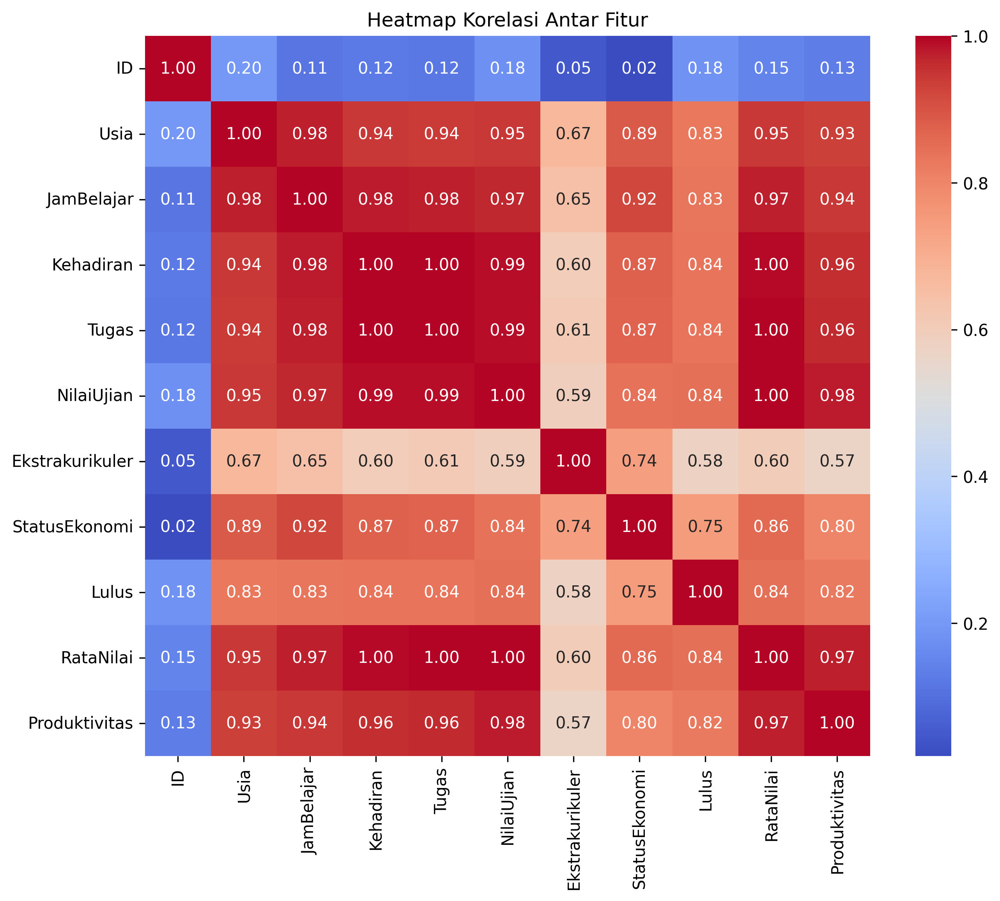
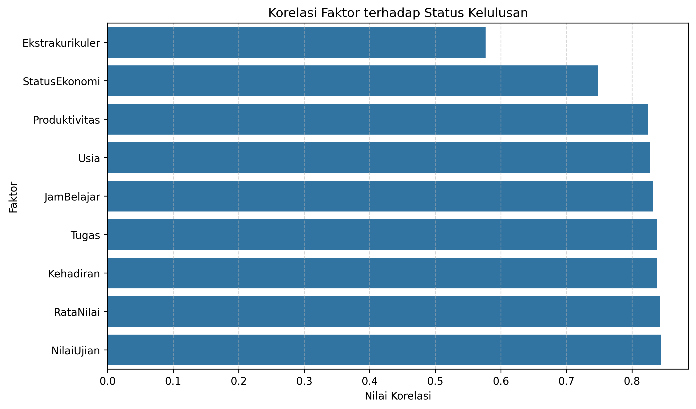

# Student Graduation Correlation Analysis

A data analysis project using Python to explore the relationship between students' academic performance, study habits, extracurricular activities, socioeconomic status, and graduation status.

## Overview

This project focuses on analyzing the correlation between student characteristics and graduation status.

Using data preprocessing, feature engineering, and correlation analysis, this project explores patterns and relationships among academic and non-academic factors that may be associated with student graduation.

## Features

- Categorical data encoding.
- Data normalization using MinMaxScaler.
- Feature engineering.
- Correlation matrix calculation.
- Correlation heatmap visualization.
- Graduation correlation bar chart.
- Exporting analysis results into CSV files.

## Dataset

The dataset contains student information with the following attributes:

| Attribute | Description |
|---|---|
| ID | Student identifier |
| Usia | Student age |
| JamBelajar | Study hours |
| Kehadiran | Attendance |
| Tugas | Assignment score |
| NilaiUjian | Exam score |
| Ekstrakurikuler | Extracurricular participation |
| StatusEkonomi | Economic status |
| Lulus | Graduation status |

## Data Processing

The analysis consists of the following steps:

1. Load the student dataset.
2. Convert categorical values into numerical representations.
3. Normalize selected numerical attributes using MinMaxScaler.
4. Create `RataNilai` from assignment and exam scores.
5. Create `Produktivitas` from study hours and attendance.
6. Calculate correlations between numerical variables.
7. Visualize the results using a heatmap and bar chart.

## Technologies

- Python
- Pandas
- Scikit-learn
- Matplotlib
- Seaborn
- Google Colab

## Project Structure

```text
student-graduation-correlation-analysis/
├── README.md
├── miniEvaluationProject.py
├── requirements.txt
├── Soal Latihan pertemuan 13.csv
└── outputs/
    ├── correlation-heatmap.png
    ├── graduation-correlation.png
    ├── correlation-results.csv
    └── graduation-correlation-results.csv
```

## Results & Visualization

### 1. Correlation Heatmap

Visualizes the correlation values between numerical variables in the dataset.



### 2. Graduation Correlation

Displays the correlation between student attributes and graduation status.



## Output Files

| File | Description |
|---|---|
| correlation-heatmap.png | Correlation heatmap visualization |
| graduation-correlation.png | Graduation correlation chart |
| correlation-results.csv | Complete correlation matrix |
| graduation-correlation-results.csv | Correlation values related to graduation |

## Installation & Usage

Install the required libraries:

```bash
pip install -r requirements.txt
```

Run the Python script:

```bash
python miniEvaluationProject.py
```

Make sure the dataset CSV file is located in the same directory as the Python script.

## Notes

Correlation analysis identifies relationships between variables. It does not prove that a particular factor directly causes a student to graduate.

---

**Project Focus:** Data Analysis | Correlation Analysis | Student Performance
